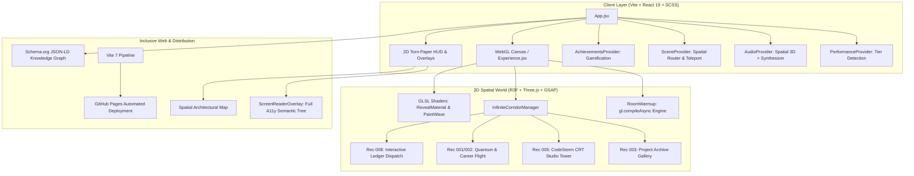

# Implementation Plan: 3D Spatial Refactor of Syed Salman Reza Portfolio

Transforming [syed-reza98.github.io](https://syed-reza98.github.io) from a 2D static HTML page into an **Awwwards Site of the Year / FWA-caliber interactive 3D WebGL experience**, leveraging the architectural blueprints, shader physics, spatial storytelling, and performance standards of [`portfolio-itom`](file:///home/syed/Workspace/portfolio-itom) alongside the **Creative Developer 2026** methodology.

---

## 1. Goal Description

### Context & Objective
The user's existing website at `/home/syed/Workspace/syed-reza98.github.io` is titled **"The Engineer's Ledger"**. It is a single-file static HTML/CSS/JS page detailing Syed Salman Reza's background as a full-stack engineer, systems architect, and founder of CodeStorm Hub, with a career rooted in banking systems (ATM electronic-journal extraction, financial reconciliation microservices, POS terminal firmware in C), mobile applications (Flutter, ML Kit), multi-tenant SaaS, and AI tooling.

While the conceptual theme ("The Ledger & Electronic Journal") is strong, the implementation is entirely static 2D. 

**The objective:** Re-architect and refactor the repository into a state-of-the-art **WebGL 3D spatial experience** matching the quality, delight, and technical execution of [`portfolio-itom`](file:///home/syed/Workspace/portfolio-itom):
- An interactive entrance portal with atmospheric tactile props.
- An infinite 3D corridor with sawtooth wall geometry, kinetic splitting typography, an avatar that physically dodges the user, and inspectable holographic frames.
- Four bespoke 3D interactive rooms (Projects Gallery, Studio Monitor Tower, Quantum/Sky Story Flight, and an interactive Physical Contact Note).
- Custom GLSL brush-stroke reveal and digital paint wave shaders.
- Spatial 3D Web Audio with positional ambient tracks, tactile SFX, and procedural Web Audio synthesizers.
- Zero-jank performance via `gl.compileAsync` off-screen shader pre-compilation and adaptive device tiering.
- 100% accessibility (A11y) via an invisible screen reader mirror and structured Schema.org JSON-LD SEO graph.
- Automated GitHub Actions build and deployment pipeline targeting GitHub Pages.

---

## 2. User Review Required

> [!IMPORTANT]
> **Repository Architecture & Toolchain Migration:**
> Currently, the repository contains a single root `index.html` deployed directly to GitHub Pages without a build step. We will transform this repository into a modern **Vite + React 19 + Three.js + R3F + GSAP + Sass** project. 
> The `.github/workflows/deploy.yml` will be updated to automatically execute `npm ci` and `npm run build`, deploying the compiled `dist/` directory directly to GitHub Pages. All your existing URLs and routes will be preserved.

> [!WARNING]
> **Creative Direction Selection:**
> In `portfolio-itom`, the metaphor is an artistic hand-drawn sketch paper notebook. For Syed's portfolio, we have three compelling creative directions. Please review and select your preferred visual style:
> - **Option A (The High-Security Cyber-Ledger — Recommended):** Merges warm drafting paper and architectural blueprints with glowing amber CRT terminal phosphor (`#FFB000`), tactile brass vault doors, and floating electronic-journal receipt rolls.
> - **Option B (The Hand-Drawn Paper Universe — Direct ITom Homage):** Pure hand-drawn sketchbook with charcoal lines, paper textures, torn-edge cards, and watercolor paint reveal shaders.
> - **Option C (Neo-Brutalist Technical Archive):** Active Theory / Obys Agency editorial style with raw monospace typography, wireframe 3D geometries, metallic surfaces, and quantum circuit visualizers.

---

## 3. Open Questions

> [!NOTE]
> 1. **Content Management Strategy:**
>    - *Option 1 (Zero-Cost Local Config - Recommended):* Keep project data in a typed configuration file (`src/config/portfolioData.js`). Easy to maintain directly via Git commits, zero external API keys or cloud dependencies needed.
>    - *Option 2 (Headless CMS):* Connect to a free Sanity.io project like `portfolio-itom`, enabling dynamic visual editing of projects, field notes, and awards from a separate studio.
> 2. **Room 3 Metaphor (About / Experience):**
>    - Would you prefer an **Origami Paper Airplane Flight** (like ITom) or a **Quantum Circuit / Cyber-Data Highway** flight where the camera flies through 3D quantum logic gates (Hadamard, CNOT, Pauli-X) and floating code tokens?
> 3. **Room 4 Metaphor (Contact):**
>    - Would you prefer the **Message in a Bottle on Ocean Waves** (like ITom) or a **Pneumatic Bank Vault Tube / Encrypted Teletype Dispatch** where you type on a ledger note and it gets sucked into a pneumatic tube or stamped with an official wax/ledger seal?

---

## 4. Architectural Transformation & System Design



---

## 5. Detailed Component & File Implementation Plan

### Phase 1: Toolchain & Build Pipeline Setup

#### [NEW] `package.json`
Configure dependencies mirroring the cutting-edge React 19 + Three.js + GSAP stack:
```json
{
  "name": "syed-reza-portfolio",
  "private": true,
  "version": "2.0.0",
  "type": "module",
  "scripts": {
    "dev": "vite",
    "build": "vite build",
    "lint": "eslint .",
    "preview": "vite preview"
  },
  "dependencies": {
    "@gsap/react": "^2.1.2",
    "@react-three/drei": "^10.7.7",
    "@react-three/fiber": "^9.4.2",
    "@react-three/postprocessing": "^3.0.4",
    "gsap": "^3.14.2",
    "react": "^19.2.0",
    "react-dom": "^19.2.0",
    "three": "^0.182.0"
  },
  "devDependencies": {
    "@vitejs/plugin-react": "^5.1.1",
    "sass": "^1.97.1",
    "vite": "^7.2.4",
    "vite-plugin-compression": "^0.5.1"
  }
}
```

#### [NEW] `vite.config.js`
Enable compression, React 19 fast-refresh, asset hashing, and base paths for GitHub Pages:
```javascript
import { defineConfig } from 'vite';
import react from '@vitejs/plugin-react';
import viteCompression from 'vite-plugin-compression';

export default defineConfig({
  plugins: [react(), viteCompression()],
  base: '/',
  build: {
    outDir: 'dist',
    assetsInlineLimit: 4096,
    chunkSizeWarningLimit: 1600,
  }
});
```

#### [MODIFY] `.github/workflows/deploy.yml`
Update the existing workflow to build Vite into `dist/` before deployment:
```yaml
name: Deploy site to GitHub Pages

on:
  push:
    branches: ["main"]
  workflow_dispatch:

permissions:
  contents: read
  pages: write
  id-token: write

concurrency:
  group: "pages"
  cancel-in-progress: false

jobs:
  build:
    runs-on: ubuntu-latest
    steps:
      - name: Checkout
        uses: actions/checkout@v4

      - name: Setup Node.js
        uses: actions/setup-node@v4
        with:
          node-version: 20
          cache: 'npm'

      - name: Install dependencies
        run: npm ci

      - name: Build site with Vite
        run: npm run build

      - name: Setup Pages
        uses: actions/configure-pages@v5

      - name: Upload artifact
        uses: actions/upload-pages-artifact@v3
        with:
          path: './dist'

  deploy:
    environment:
      name: github-pages
      url: ${{ steps.deployment.outputs.page_url }}
    runs-on: ubuntu-latest
    needs: build
    steps:
      - name: Deploy to GitHub Pages
        id: deployment
        uses: actions/deploy-pages@v4
```

---

### Phase 2: Design Tokens, Shaders & Context Engine

#### [NEW] `src/styles/_variables.scss` & `src/styles/_mixins.scss`
Incorporate the dual **Warm Paper Ledger + Amber Terminal** design token system:
```scss
// Colors: Warm Paper Ledger + Amber Terminal Phosphor
$color-bg: #F2EDE1;
$color-surface: #FAF7EE;
$color-panel: #16130D;
$color-panel-amber: #FFB000;
$color-panel-dim: #9C7C30;
$color-ink: #1B1710;
$color-ink-secondary: #59523F;
$color-accent: #855400;

// Typography
$font-mono: ui-monospace, SFMono-Regular, "Cascadia Mono", Consolas, monospace;
$font-sketch: 'Cabin Sketch', cursive;
$font-handwritten: 'Caveat', cursive;
$font-headline: 'Gloria Hallelujah', cursive;
$font-sans: 'Inter', -apple-system, BlinkMacSystemFont, sans-serif;
```

#### [NEW] `src/components/canvas/shaders/RevealMaterial.jsx`
Implement the ITom procedural brush-stroke alpha-discard shader for sketch $\to$ color transitions.

#### [NEW] `src/components/canvas/shaders/PaintRevealMaterial.jsx`
Implement the world-space traveling watercolor wave shader with emissive borders.

#### [NEW] Context Providers:
- `src/context/PerformanceContext.jsx`: Adaptive DPR (`[1, 2]` on desktop, capped at `1.5` on mobile), shadow controls, and performance throttling.
- `src/context/SceneContext.jsx`: Room state tracking, deep linking (`/projects`, `/experience`, `/contact`), and paper tear transition phases.
- `src/context/AudioManager.jsx`: Spatial audio management, volume controls, mute toggling, and Web Audio synthesized achievement bells.
- `src/context/AchievementsContext.jsx`: Gamified milestones (`ledger_opened`, `vault_explored`, `quantum_tuned`, `barrel_inspected`).

---

### Phase 3: Infinite 3D Corridor & Spatial Navigation

#### [NEW] `src/components/canvas/corridor/InfiniteCorridorManager.jsx`
Procedural repeating corridor manager with `SegmentVisibilityWrapper` to cull non-visible segments and maintain 60 FPS.

#### [NEW] `src/components/canvas/corridor/CorridorWalls.jsx`
Sawtooth wall geometry ($\theta \approx 24^\circ$) featuring hand-drawn wooden planks, baseboards, ventilation grates, and ceiling lamps with fluorescent bulb geometry.

#### [NEW] `src/components/canvas/corridor/HeroText.jsx`
Monumental 3D kinetic text:
- Displays **"SYED REZA"** in Rubik Scribble / Cabin Sketch.
- Subtitle: **`< systems architect />`**.
- As the camera approaches along the $Z$-axis, individual letters dynamically split and part laterally, allowing the camera to pass through.

#### [NEW] `src/components/canvas/corridor/Avatar.jsx`
Hand-drawn sketch avatar that waves at the user, tracks camera proximity, and steps sideways out of the way when the user scrolls forward.

#### [NEW] `src/components/canvas/corridor/DoorSection.jsx`
Angled doors corresponding to the 4 records:
- **Door 1:** `THE ARCHIVE` (Projects & Transaction History)
- **Door 2:** `THE TERMINAL` (CodeStorm Hub & Tech Stack)
- **Door 3:** `THE ODYSSEY` (Banking Systems, Quantum Capstone & Journey)
- **Door 4:** `THE DISPATCH` (Hire Me & Electronic Journal Contact)

---

### Phase 4: The Four Spatial Rooms

#### [NEW] `src/components/canvas/rooms/Archive/ArchiveRoom.jsx` (Rec 003: Projects)
- **Setting:** A high-security architectural archival gallery.
- **Components:**
  - 10 project transaction tickets (PetFolio, Awaken, StormCom, AI Tooling, F. Rahman, NetCon, Bike Helmet Detection, Quantum Defense, SR600Mini, Allora).
  - Cards suspended on lines or bank safety-deposit racks.
  - Clicking any card flips it $180^\circ$, revealing technology logos, live links, and interactive benchmark metrics.

#### [NEW] `src/components/canvas/rooms/Terminal/TerminalRoom.jsx` (Rec 005: CodeStorm Studio)
- **Setting:** Cyber-terminal room featuring a cylindrical tower of CRT monitors.
- **Components:**
  - Falling CRT monitors displaying CodeStorm Hub flagships, GitHub stats (33+ repos, 7 engineers), and AMD Hackathon badges.
  - Horizontal drag physics and vertical scroll cycling.
  - Floating code particles: `{/}`, `</>`, `SQL`, `ATM`, `PRISMA`, `FLUTTER`, `QISKIT`.

#### [NEW] `src/components/canvas/rooms/Odyssey/OdysseyRoom.jsx` (Rec 001/002: Career Journey)
- **Setting:** Infinite procedural sky / quantum space flight.
- **Components:**
  - User pilots a 3D origami paper plane or quantum probe.
  - Camera rolls and banks with scroll inertia.
  - Encounters 3D milestones: North South University, Networld Technology (ATM EJ extraction, reconciliation), Oracle Certifications, and interactive popping balloons revealing core skill proficiencies.

#### [NEW] `src/components/canvas/rooms/Dispatch/DispatchRoom.jsx` (Rec 008: Contact & Engagement)
- **Setting:** Dock overlooking water with floating barrels (LinkedIn, GitHub, Upwork, Email) and a physical ledger desk.
- **Components:**
  - 3D torn ruled paper notebook form where users write in sketch typography.
  - Bigram NLP anti-spam scoring.
  - Submitting rolls the message into a bottle or pneumatic vault capsule and launches it across the rolling water waves.

---

### Phase 5: HUD, Navigation, Accessibility & SEO

#### [NEW] `src/components/ui/NavigationUI.jsx`
- Architectural blueprint map of the rooms.
- Moving pin indicator animated with GSAP.
- Pinned torn-paper control buttons (Sound, Map, Back, Achievements).

#### [NEW] `src/components/dom/PaperTransition.jsx`
- Organic paper tear transition triggered during teleportation with authentic paper rip audio.

#### [NEW] `src/components/dom/Preloader.jsx`
- Real-time progress bar tracing a jagged tear-line with pencil sketching audio, opening into two rotating paper halves.

#### [NEW] `src/components/ui/ScreenReaderOverlay.jsx`
- Invisible semantic HTML layer mirroring all 3D rooms, projects, and contacts for complete screen reader accessibility (100% Lighthouse A11y).

---

## 6. Verification & Quality Assurance Plan

### Automated Validation
```bash
# 1. Clean installation of dependencies
npm ci

# 2. Production build verification
npm run build

# 3. Code quality and hook rules check
npm run lint

# 4. Local production preview test
npm run preview
```

### Manual Verification Checklist
1. **Entrance Flow:**
   - Preloader percentage tracks texture decoding without React state thrashing.
   - Entrance doors open with 3D spatial sound (`otwarciedrzwi.mp3`).
   - Background music initiates cleanly upon first user interaction.
2. **Corridor Navigation:**
   - Scroll inertia is buttery-smooth on mouse wheel, drag, touch, and keyboard (Arrow keys).
   - "SYED REZA" hero text splits cleanly without letter collision.
   - Avatar steps aside smoothly as camera approaches.
   - Picture frames pull off the wall smoothly upon click.
3. **Room Transitions:**
   - Doors swing open and camera zooms in without clipping through geometry.
   - Paint reveal shader sweeps across the room without frame drops.
   - Back button returns camera to corridor with a 30-frame smooth blend (no snapping).
   - Map teleportation triggers paper tear animation and lands directly in target room.
4. **Performance & Cross-Device QA:**
   - DevTools Performance tab verifies locked 60 FPS on desktop.
   - Mobile emulation activates `MEDIUM` or `LOW` tier (disabling shadows, lowering DPR to 1.0-1.5, bypassing heavy pre-warmups).
   - Lighthouse Audit: Score $\ge 90$ on Accessibility, Best Practices, and SEO.

---

## 7. Next Steps & Execution Order

Once approved, implementation will proceed through the following stages:
1. **Stage 1:** Scaffold Vite + React 19 toolchain, dependencies, and GitHub Actions workflow.
2. **Stage 2:** Implement SCSS design tokens, context providers, audio engine, and GLSL shaders.
3. **Stage 3:** Build `Experience.jsx`, `RoomWarmup.jsx`, and `InfiniteCorridorManager.jsx` with full corridor geometry and kinetic typography.
4. **Stage 4:** Build the 4 interactive rooms (Archive, Terminal, Odyssey, Dispatch) populated with Syed's actual projects, skills, and banking history.
5. **Stage 5:** Integrate `NavigationUI`, `PaperTransition`, `Preloader`, `ScreenReaderOverlay`, and complete end-to-end verification.